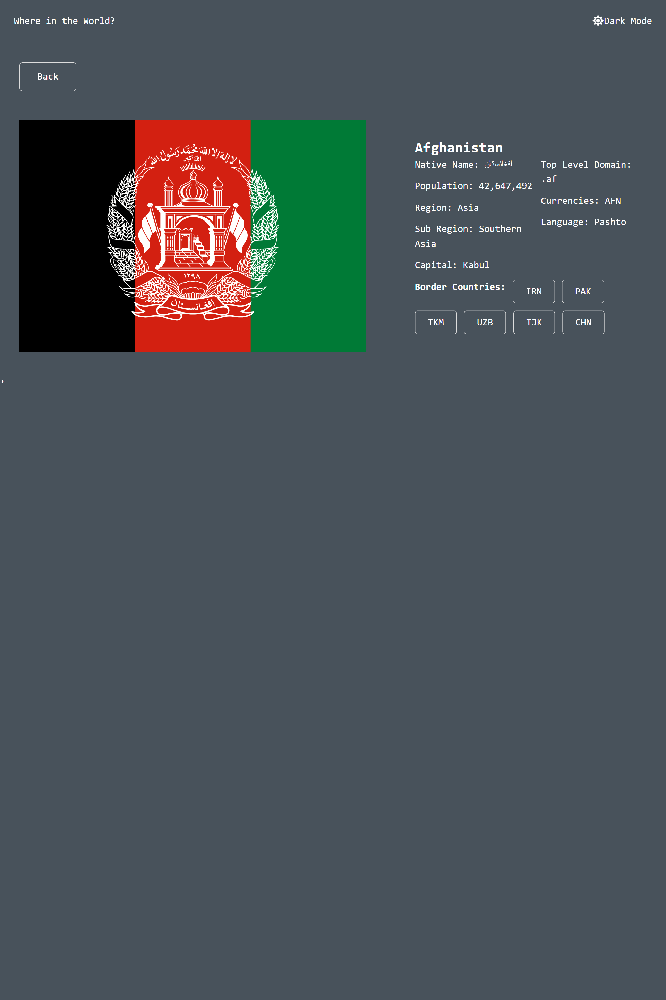

# REST Countries API with Color Theme Switcher

A responsive country information application built with React. The application displays country information using local JSON data and allows users to search, filter, explore country details, and switch between light and dark themes.

## Features

- Display countries with their flags, population, region, and capital.
- Search for countries by name.
- Filter countries by region.
- View detailed information about individual countries.
- Navigate between countries using border countries.
- Toggle between light and dark themes.
- Responsive design for desktop and mobile devices.

## Live Demo & Links

- Live Site: [View Live Project](https://6b0961abd822d0feddbdaf63--rest-countries-okedo01.netlify.app/)
- Frontend Mentor Solution: [View Solution](YOUR_FRONTEND_MENTOR_SOLUTION_URL)
- Frontend Mentor Challenge: [View Challenge](https://www.frontendmentor.io/challenges/rest-countries-api-with-color-theme-switcher-5cacc469fec04111f7b848ca)

## Screenshots

### Desktop View

### Mobile View

### Dark Mode

### Country Details Page

## Built With

- HTML5
- CSS3
- JavaScript (ES6+)
- React
- React Router DOM
- Vite
- Local JSON data (`data.json`)
- Font Awesome

## What I Learned

Working on this project helped me strengthen my React development skills.

Key concepts I practiced:

- Managing component state using React Hooks.
- Passing data between components using props.
- Reading and rendering data from a local JSON file.
- Implementing search and filtering functionality.
- Handling dynamic routes with React Router DOM.
- Building reusable React components.
- Implementing light and dark themes.
- Creating responsive layouts using CSS.

## Challenges and Solutions

One of the main challenges was organizing country data and displaying the correct information on different pages.

I practiced using React Router for navigation and dynamic route parameters to display individual country details.

I also worked on managing theme state and updating the application's appearance dynamically.

## Continued Development

I plan to improve my skills in:

- React state management.
- Custom hooks.
- API integration.
- Component reusability.
- Performance optimization.
- Advanced React Router concepts.

## AI Collaboration

I used ChatGPT as a learning and development assistant during this project.

It helped me understand React concepts, troubleshoot errors, explore implementation approaches, and improve my problem-solving skills.

## Author

- GitHub: [@okedo01](https://github.com/okedo01)
- Frontend Mentor: [@yourusername](https://www.frontendmentor.io/)